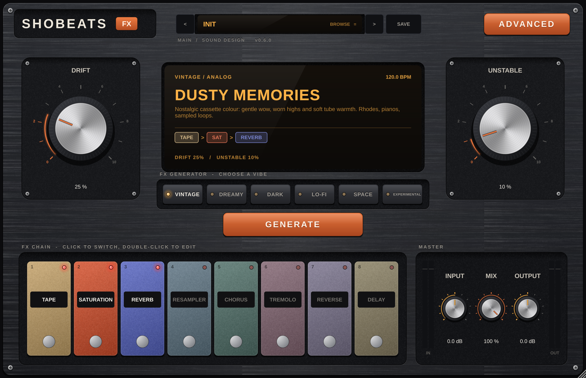
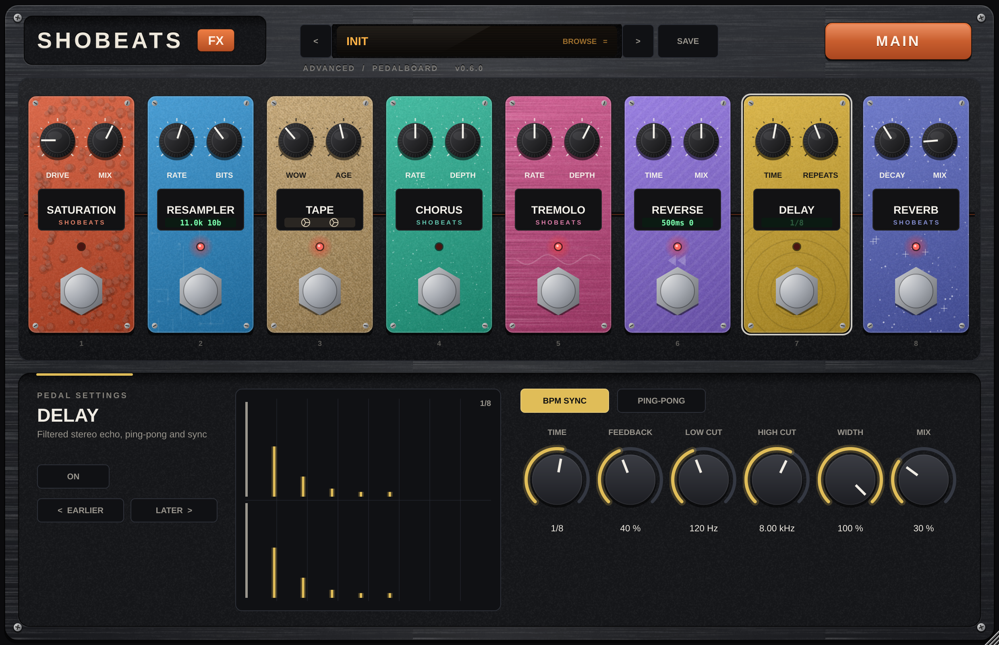

# SHOBEATS FX

An analog-style multi-effects pedalboard plugin (VST3, Windows x64) built with C++ and JUCE.





## Effects

Eight pedals, every control processes audio:

| Pedal | Controls |
| --- | --- |
| Saturation | Character (Soft / Warm / Hard / Fuzz / Fold), Drive, Tone, Output, Mix — 4x oversampled |
| Resampler | Rate (500 Hz – 48 kHz), Bits (2 – 24), Filter, Jitter, Mix |
| Tape | Saturation, Wow, Flutter, Noise (hiss), Age (head wear + dropouts), Mix |
| Chorus | Rate, Depth, Delay, Feedback, Width, Mix |
| Tremolo | Shape (Sine / Triangle / Square / Saw), Rate or BPM-synced division, Depth, Stereo (auto-pan) |
| Reverse | Length (ms or BPM-synced), Pitch (±12 st), forward/reverse Mix |
| Delay | Time (ms or BPM-synced), Feedback, Low Cut, High Cut, Ping-Pong, Width, Mix |
| Reverb | Size, Decay, Damping, Pre-Delay, Width, Mix |

Global: Input, Mix (whole chain wet/dry, latency-aligned), Output, peak meters, host tempo display,
and two analog-movement controls that act on every active pedal:

- **Drift** – slow wander: tape wow, delay-time and chorus/tremolo rate drift, per-segment detune, drive drift, lusher reverb modulation
- **Unstable** – fast irregularity: flutter and dropouts, delay wobble/jitter, chorus voice jitter, resampler clock jitter, tremolo depth flicker

## Presets and the FX Generator

- **60 original factory presets** in six categories (Vintage / Analog, Dreamy / Ambient, Dark / Trap,
  Lo-Fi / Texture, Space / Experimental, Creative / Movement) – see [docs/PRESETS.md](docs/PRESETS.md).
  They are JSON files in `presets/factory/`, compiled into the plugin.
- **Preset browser** with categories, search and descriptions; previous/next buttons; **Save** for user presets
  (stored as `.sfxpreset` files in `%APPDATA%\SHOBEATS\SHOBEATS FX\Presets`, listed under *User*).
- **FX Generator**: pick a vibe (Vintage, Dreamy, Dark, Lo-Fi, Space, Experimental) and press **GENERATE**.
  Each vibe is a curated recipe (signature pedal, likely pedals, safe parameter ranges, order template,
  movement ranges, loudness trim). Every press gives a new idea; press **Save** to keep it.
- Loading a preset or generating fades out, swaps and clears old tails in silence, then fades in – no clicks
  or level spikes while audio plays. The DAW project stores parameters, pedal order and the preset name.

## Using it

**Main view** – Drift and Unstable, the preset display, the vibe keys and GENERATE, the FX chain
(click a tile to switch a pedal, double-click to open it), and Input / Mix / Output.

**Advanced view** (ADVANCED button) – the full pedalboard:

- **Stomp** a pedal's footswitch to switch it on/off (red LED = on). New instances start with every pedal off.
- **Turn** the two knobs on a pedal for its main controls. Shift-drag for fine control, double-click to reset.
- **Click** a pedal to show every control and a live display in the settings panel below.
- **Drag** a pedal left/right to change the processing order (or use *Earlier / Later*).
- Synced effects follow the host tempo (shown in the main display).

## Status

| Milestone | Content | State |
| --- | --- | --- |
| M1 | Saturation, chorus, reverb, CMake, CI | Done |
| M2 | 8 effects, reorderable chain, global mix, BPM sync, pedalboard UI + advanced panel | Done |
| M3 | Global Drift / Unstable analog movement | Done |
| M4 | 60 factory presets, browser, user presets, click-free switching | Done |
| M5 | FX Generator (Vintage, Dreamy, Dark, Lo-Fi, Space, Experimental) | Done |
| M6 | Hardware-style Main view and Advanced pedalboard | Done |

## Testing in FL Studio (Windows)

1. Open the latest green run of **Windows build** under the repository's *Actions* tab.
2. Download the artifact **ShobeatsFX-VST3-Windows-x64-Release** and unzip it.
3. Copy the whole `ShobeatsFX.vst3` folder to `C:\Program Files\Common Files\VST3\`.
4. In FL Studio: *Options → Manage plugins → Find more plugins* (or *Find installed plugins*).
5. Load **SHOBEATS FX** on a mixer insert.

## Building

Requirements: CMake ≥ 3.22, Visual Studio 2022 or newer, Git.

```bash
git clone --recurse-submodules <this repo>
```

```bash
cmake -S . -B build -A x64
```

```bash
cmake --build build --config Release --parallel
```

```bash
ctest --test-dir build -C Release --output-on-failure
```

The bundle is written to `build/ShobeatsFX_artefacts/Release/VST3/ShobeatsFX.vst3`.

| CMake option | Default | Meaning |
| --- | --- | --- |
| `SHOBEATS_BUILD_TESTS` | `ON` | Build the unit tests |
| `SHOBEATS_BUILD_STANDALONE` | `OFF` | Also build a standalone app |

Set `SHOBEATS_SNAPSHOT=path/prefix` when running the `[gui]` plugin tests to save UI renderings.

## Repository layout

```
source/dsp/       Plain C++ DSP for the eight effects (no JUCE, no allocation while processing)
source/ui/        Look-and-feel, pedals, pedalboard, advanced panel, displays
source/           Processor, parameters, chain order, editor
tests/            Catch2 tests: DSP behaviour, bypass, state recall, automation, editor
libs/JUCE         JUCE 8.0.17-security, pinned submodule (commit dabd5ad)
libs/Catch2       Catch2 v3.8.1, pinned submodule (commit 2b60af8)
.github/workflows Windows x64 Release build, tests, pluginval, VST3 artifact upload
```

## Continuous integration

Every push builds Release x64 on Windows, runs all unit tests, checks the VST3 bundle layout,
validates the plugin with pluginval at strictness level 10, and uploads the complete
`ShobeatsFX.vst3` bundle as an artifact.
